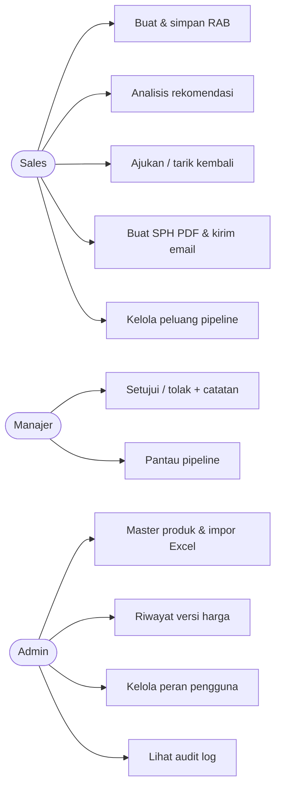
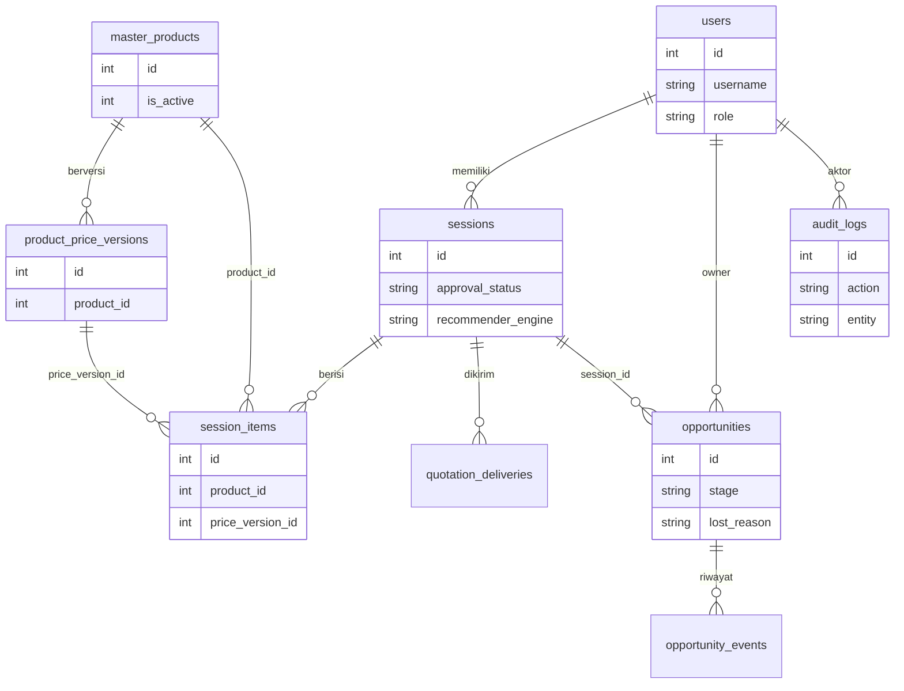
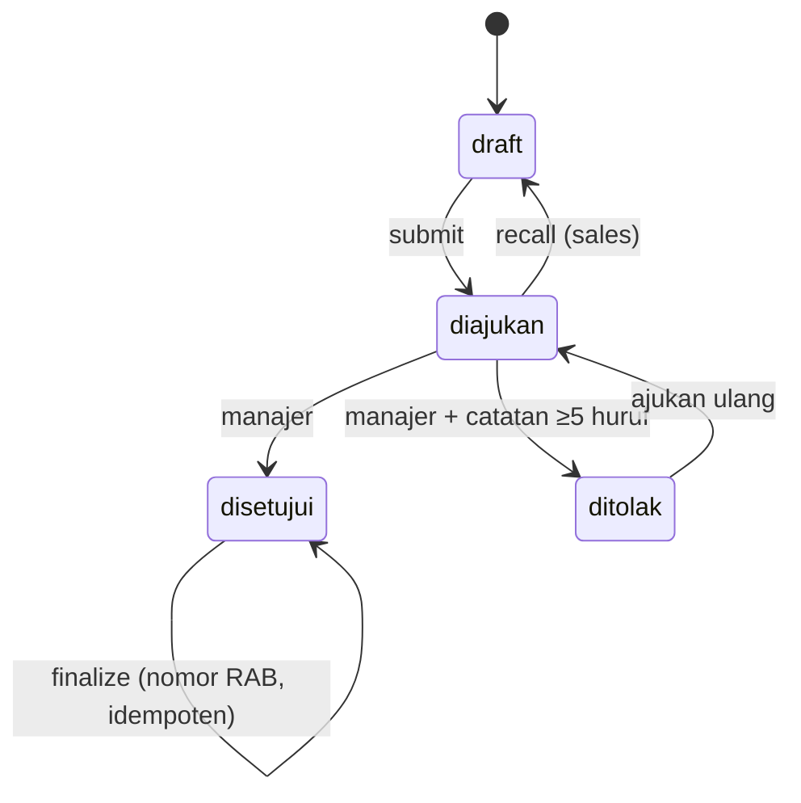

# Desain Sales Assist 2.0 (Minggu 6–7)

## Use case

## ERD

## Alur persetujuan

## Alur pipeline
prospek → penawaran | kalah; penawaran → negosiasi | menang | kalah; negosiasi → penawaran | menang | kalah. Menang/kalah final; kalah wajib `lost_reason`. Win rate = menang/(menang+kalah).

## Daftar API (prefiks `/api`)
| Area | Endpoint |
|---|---|
| auth | POST login, register, google; GET google/config |
| sessions | POST/GET `/`; GET/PUT/DELETE `/:id`; POST `/:id/analyze`, `/items`, `/clone`; POST `/:id/submit`, `/recall`, `/decision`, `/approve`; GET `/:id/audit`, `/price-trace`, `/quotation.pdf`, `/deliveries`, `/rab.xlsx`; POST `/:id/send-quotation` |
| approvals | GET `/` (antrean manajer) |
| master-data | GET/POST `/`; GET/PUT/DELETE `/:id`; GET `/:id/versions`; POST `/:id/reactivate`, `/import` (dry_run); GET `/import/template.xlsx` |
| pipeline | GET `/`, `/summary`, `/reminders`; POST `/`, `/:id/stage`; PUT/DELETE `/:id` |
| audit, users | GET `/audit`; GET `/users`, PUT `/users/:id/role` |

## Rekomendasi hibrida
Skor = 0,75·TF-IDF(konten layanan, normalisasi Indonesia) + 0,25·kNN riwayat RAB disetujui; tanpa riwayat → konten saja. Baseline KP (`aiMatcher.js`) dibekukan untuk pembanding.
